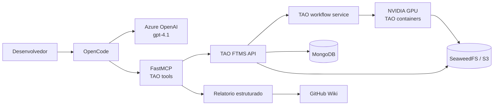
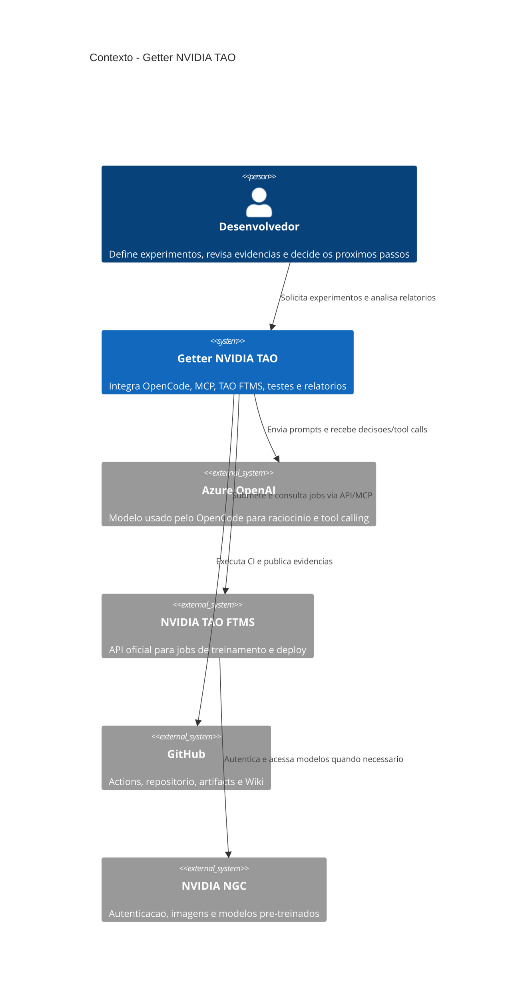
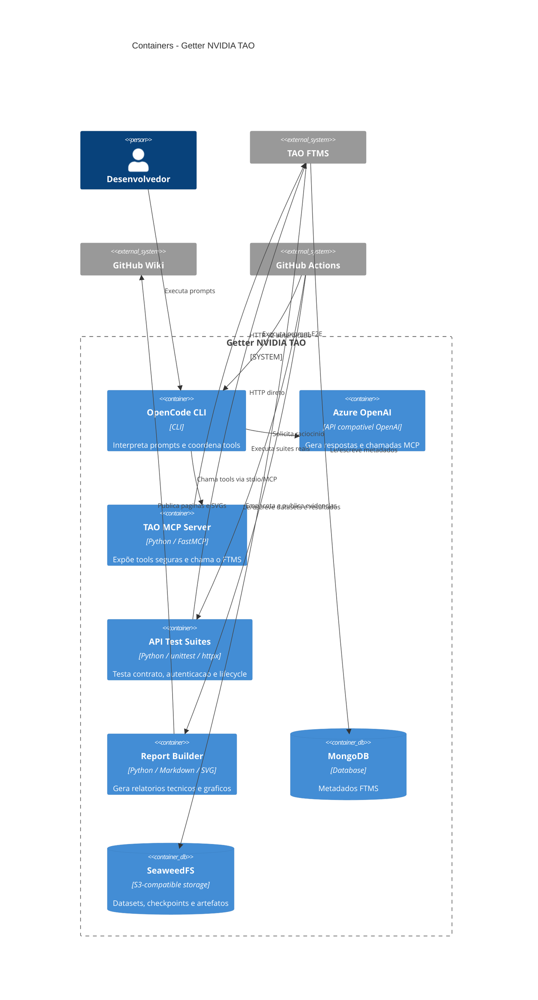
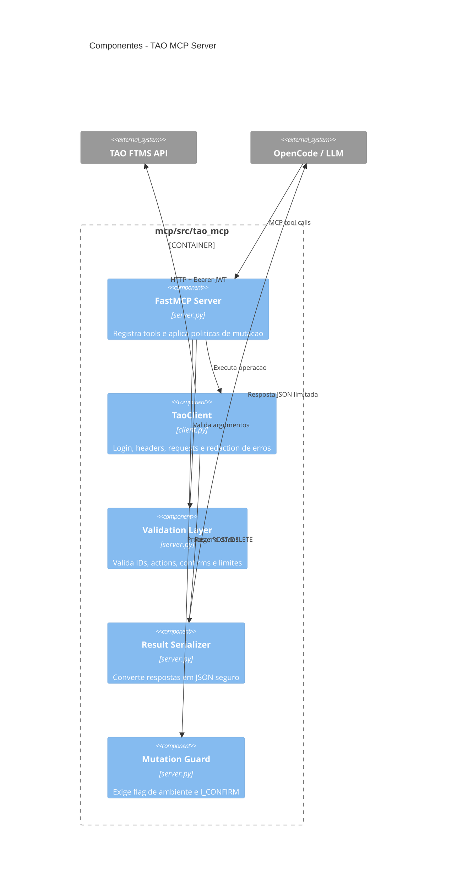
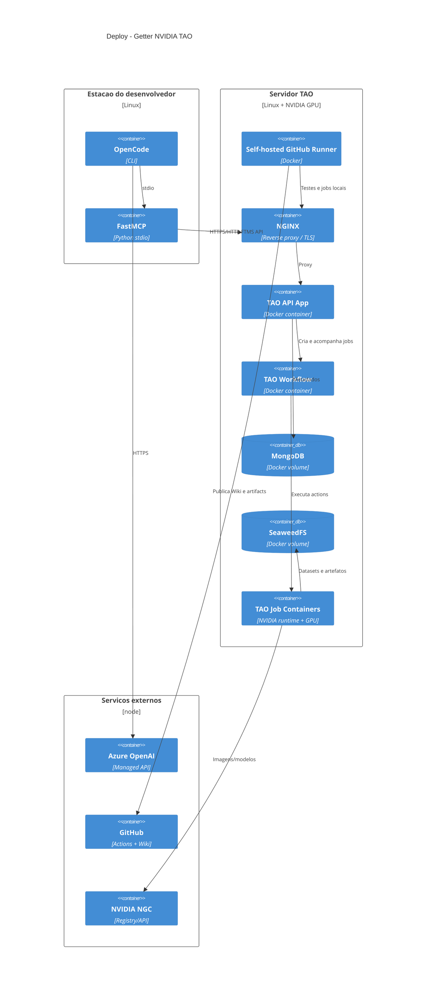
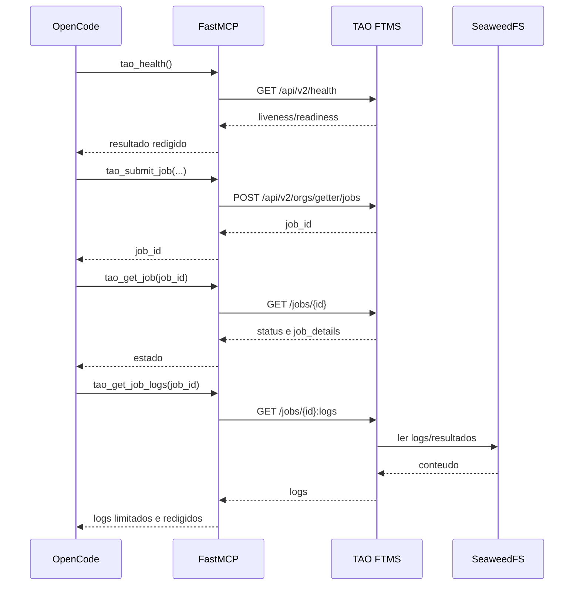
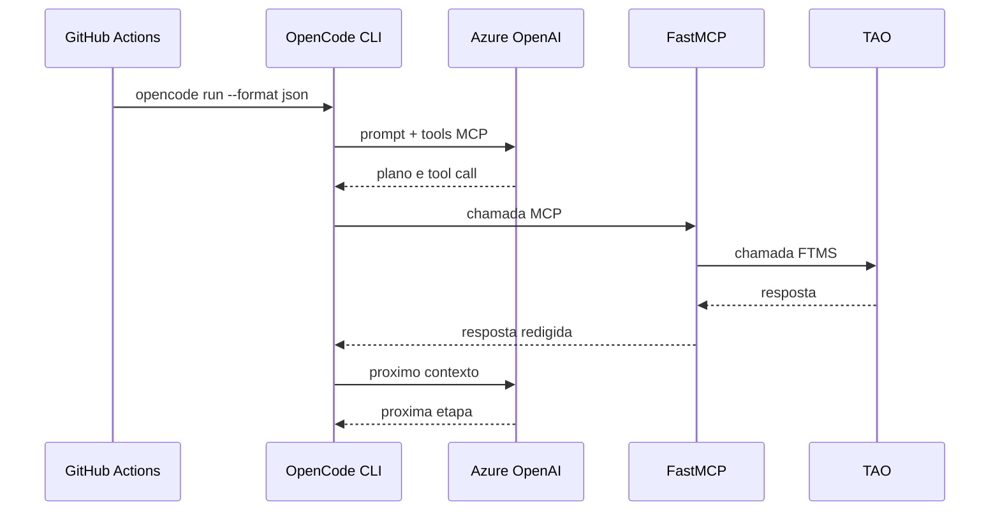
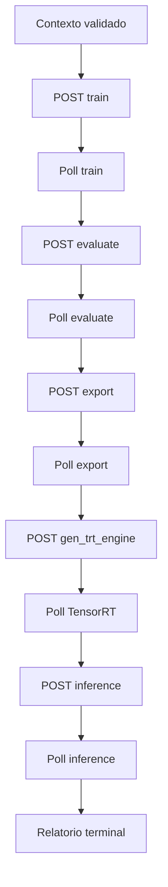
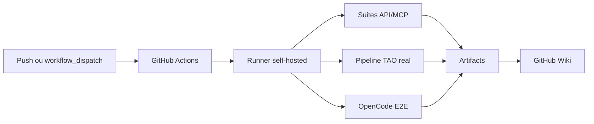

# Arquitetura do Getter NVIDIA TAO

## 1. Visao Geral

Este projeto e uma camada operacional em torno do NVIDIA TAO Finetuning
Microservice (FTMS). O repositorio nao reimplementa o TAO: ele instala,
configura, testa e integra os servicos oficiais da NVIDIA com:

- Docker Compose;
- SeaweedFS para armazenamento S3 compativel;
- FastMCP para expor a API TAO a agentes;
- OpenCode para orquestracao por linguagem natural;
- Azure OpenAI para inferencia do modelo do agente;
- GitHub Actions para testes reproduziveis;
- GitHub Wiki para relatorios tecnicos por execucao.



## 2. Camadas

| Camada | Responsabilidade | Implementacao |
| --- | --- | --- |
| Interface | Entrada humana e comandos de experimento | OpenCode |
| Raciocinio | Interpretacao do prompt e escolha de tools | Azure OpenAI |
| Adaptador | Contrato seguro de tools e autenticacao TAO | `mcp/` FastMCP |
| API | Login, workspaces, datasets, jobs e schemas | TAO FTMS v2 |
| Orquestracao | Filas, estados e execucao de containers | TAO workflow service |
| Computacao | Treino, avaliacao, exportacao e inferencia | Containers TAO + GPU |
| Persistencia | Metadados, modelos, logs e datasets | MongoDB + SeaweedFS |
| Automacao | Testes e relatorios CI | GitHub Actions + self-hosted runner |
| Evidencia | Historico tecnico e graficos | GitHub Wiki |

## 3. Modelo C4

### C4 - Contexto do Sistema

O sistema Getter NVIDIA TAO conecta pessoas, agentes, servicos de IA e o
ambiente de treinamento NVIDIA.



### C4 - Containers



### C4 - Componentes do TAO MCP Server



### C4 - Deploy



## 4. Componentes de Runtime

### TAO FTMS API

A API oficial e publicada no endpoint configurado por `TAO_BASE_URL` e usa a
organizacao definida por `TAO_ORG`.

Responsabilidades principais:

- autenticar via `/api/v2/login`;
- listar e consultar workspaces;
- listar datasets;
- consultar schemas de actions;
- listar base experiments;
- listar GPUs;
- criar e consultar jobs;
- fornecer logs;
- cancelar jobs;
- executar o workflow de treino e deploy.

O endpoint `/api/v2/login` e oficial do FTMS. Este projeto apenas encapsula o
contrato em `mcp/src/tao_mcp/client.py` e nos testes HTTP reais.

### TAO Workflow e GPU

O FTMS recebe uma especificacao e cria um job assincrono. O job pode passar por:

```text
Pending -> Started -> Running -> Done
                         \-> Error
                         \-> Canceled
```

Actions do pipeline `classification_pyt`:

```text
train
  -> evaluate
  -> export
  -> gen_trt_engine
  -> inference
```

Uma action filha deve usar `parent_job_id` e somente deve ser criada depois que
a action anterior atingir estado terminal de sucesso.

### MongoDB

Armazena metadados de FTMS, incluindo:

- workspaces;
- datasets;
- experiments;
- jobs;
- estados e detalhes de jobs.

### SeaweedFS

Fornece armazenamento S3 compativel para:

- datasets;
- checkpoints;
- resultados de treino;
- modelos exportados;
- engines TensorRT;
- artefatos de inferencia.

Os URIs usados nos testes tem o formato:

```text
seaweedfs://tao-storage/data/tao-test-classification-v1
```

Esses URIs sao identificadores internos do ambiente. Nao devem ser convertidos
em links HTTP ficticios nos relatorios.

## 5. Integracao MCP

O servidor FastMCP esta em `mcp/src/tao_mcp/` e usa um cliente HTTP pequeno,



### Tools principais

- `tao_health`
- `tao_api_info`
- `tao_list_workspaces`
- `tao_get_workspace`
- `tao_list_datasets`
- `tao_list_jobs`
- `tao_get_job`
- `tao_get_job_logs`
- `tao_get_job_schema`
- `tao_list_base_experiments`
- `tao_list_gpu_types`
- `tao_get_test_context`
- `tao_submit_job`
- `tao_cancel_job`
- `tao_create_workspace`
- `tao_delete_workspace`

### Seguranca MCP

Mutacoes exigem duas condicoes:

1. `TAO_MCP_ALLOW_MUTATIONS=true` no ambiente do processo MCP.
2. `confirm="I_CONFIRM"` no argumento da tool mutativa.

Sem essas condicoes, a tool deve rejeitar a operacao antes de chamar a API.

Credenciais nunca devem aparecer em:

- prompts;
- eventos OpenCode;
- logs;
- relatorios;
- commits;
- Wiki;
- mensagens de erro.

## 6. OpenCode e Azure OpenAI

O workflow cria uma configuracao temporaria do OpenCode. O modelo usado na
rodada real e `openai/gpt-4.1`, servido por um endpoint Azure OpenAI-compatible.



O OpenCode e adequado para:

- interpretar contexto;
- validar precondicoes;
- escolher schemas;
- submeter actions;
- produzir uma explicacao tecnica.

O OpenCode nao deve ser o unico mecanismo de polling de jobs longos. Uma
sessao de modelo pode terminar enquanto o TAO continua executando.

## 7. Arquitetura de Testes

### Camadas

| Suite | Escopo | Usa GPU | Usa MCP |
| --- | --- | ---: | ---: |
| API contract | health, OpenAPI, auth, workspace, schemas, GPUs | Nao | Nao |
| Authenticated regression | endpoints autenticados | Nao | Nao |
| MCP real | protocolo e tools FastMCP | Nao | Sim |
| Integration lifecycle | cria e remove workspace | Nao | Nao |
| TAO pipeline | train/evaluate/export/TensorRT/inference | Sim | Nao |
| OpenCode E2E | OpenCode -> Azure -> MCP -> TAO | Sim | Sim |

### Pipeline direto via API

O teste `tests/test_real_pipeline_unittest.py` envia HTTP diretamente ao FTMS,
sem mock:



### Criterio de sucesso

Uma execucao completa somente pode ser considerada `PASSED` quando:

- todas as actions esperadas foram submetidas;
- cada job terminou em `Done` ou `Completed`;
- nao existem erros de tool/API;
- logs e metricas relevantes foram coletados;
- os artefatos esperados foram identificados.

`OpenCode exit code 0` sozinho nao prova sucesso do pipeline.

## 8. GitHub Actions e Runner

O workflow esta em `.github/workflows/tao-api-tests.yml`.

O runner e um container self-hosted na maquina TAO com labels:

```text
self-hosted, linux, tao-ftms
```

O runner executa jobs que precisam acessar:

- FTMS local;
- GPU;
- SeaweedFS;
- Docker socket;
- armazenamento local.

Fluxo CI:



### Risco operacional conhecido

O host teve falhas de DNS para endpoints dinamicos do GitHub Actions. O
container podia estar `Up` enquanto o runner permanecia `offline`.

Os endpoints envolvidos incluem:

- `api.github.com`;
- `broker.actions.githubusercontent.com`;
- `tokenghub.actions.githubusercontent.com`;
- `pipelinesghubeus8.actions.githubusercontent.com`;
- `run-actions-*-azure-eastus.actions.githubusercontent.com`.

O mapeamento estatico de hosts e apenas um workaround temporario. A solucao
correta e restaurar DNS funcional no host e remover os mapeamentos estaticos.

## 9. Relatorios e Wiki

Cada execucao pode gerar uma pagina Wiki com:

- resumo da rodada;
- status de orquestracao e TAO separados;
- tabela de jobs;
- duracao por action;
- grafico de chamadas MCP;
- dataset, workspace e base experiment;
- metricas disponiveis;
- logs e dados brutos redigidos;
- analise de trade-offs;
- conclusao tecnica.

Geradores:

- `scripts/run_opencode_prompt_report.py`: captura eventos e outputs MCP.
- `scripts/build_wiki_report.py`: cria pagina Markdown e SVGs.
- `scripts/build_experiment_site.py`: gerador HTML auxiliar.

Relatorios nao devem declarar metricas ausentes como zero. A classificacao deve
ser:

- `Observado`: veio diretamente do TAO.
- `Calculado`: derivado de dados observados.
- `Inferido`: interpretacao com justificativa.
- `Nao determinado`: dado ausente.

## 10. Configuracao e Segredos

### Variaveis

- `TAO_BASE_URL`
- `TAO_ORG`
- `TAO_TEST_WORKSPACE_ID`
- `TAO_TRAIN_DATASET_URI`
- `TAO_EVAL_DATASET_URI`
- `TAO_INFERENCE_DATASET_URI`
- `TAO_BASE_EXPERIMENT_IDS`
- `TAO_REAL_NETWORK`

### Segredos

- `NGC_API_KEY`: Personal API Key para login FTMS/NGC.
- `OPENAI_API_KEY`: acesso ao modelo OpenCode.
- `TAO_TOKEN`: alternativa ao login por NGC key.

A Legacy/PTM Key deve permanecer apenas no `secrets.json` privado do runtime
TAO quando necessaria para baixar modelos pre-treinados. Nunca deve ser
versionada.

## 11. Estado Atual e Proximos Passos

Concluido:

- API FTMS real;
- MCP real;
- workspace lifecycle com fallback bulk;
- pipeline TAO completo executado com sucesso em uma rodada anterior;
- relatorios Wiki;
- captura estruturada;
- teste direto de contrato API com `6/6`.

Pendencias:

- limpar o job TAO antigo preso em `Started`;
- repetir o pipeline direto sem job orfao;
- corrigir o timeout/falha de cancelamento de jobs presos;
- manter DNS do runner estavel;
- concluir OpenCode E2E com polling terminal;
- capturar metricas, latencias, throughput e artefatos no relatorio final.

## 12. Referencias

- Workflow: `.github/workflows/tao-api-tests.yml`
- Cliente MCP: `mcp/src/tao_mcp/client.py`
- Servidor MCP: `mcp/src/tao_mcp/server.py`
- Testes API: `tests/test_api_unittest.py`
- Testes pipeline: `tests/test_real_pipeline_unittest.py`
- Runner: `runner/docker-compose.yml`
- Relatorios diretos: `docs/direct-api/`
- Diario de bordo: `diario de bordo/2026-10-02.md`
